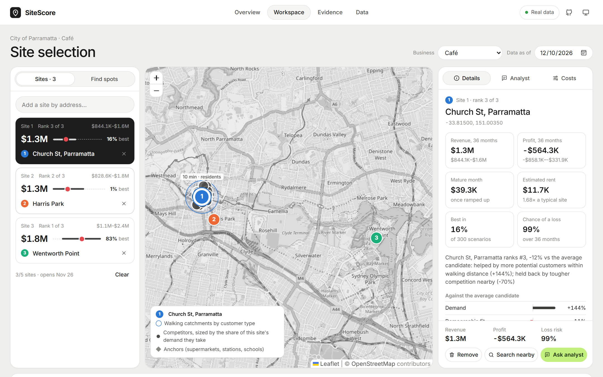
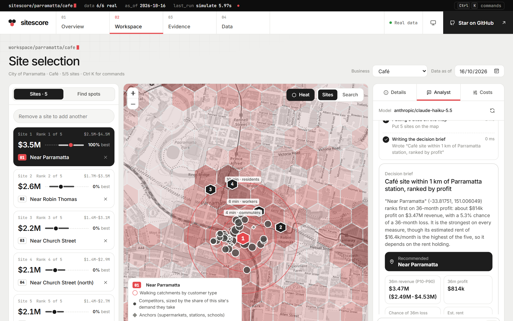
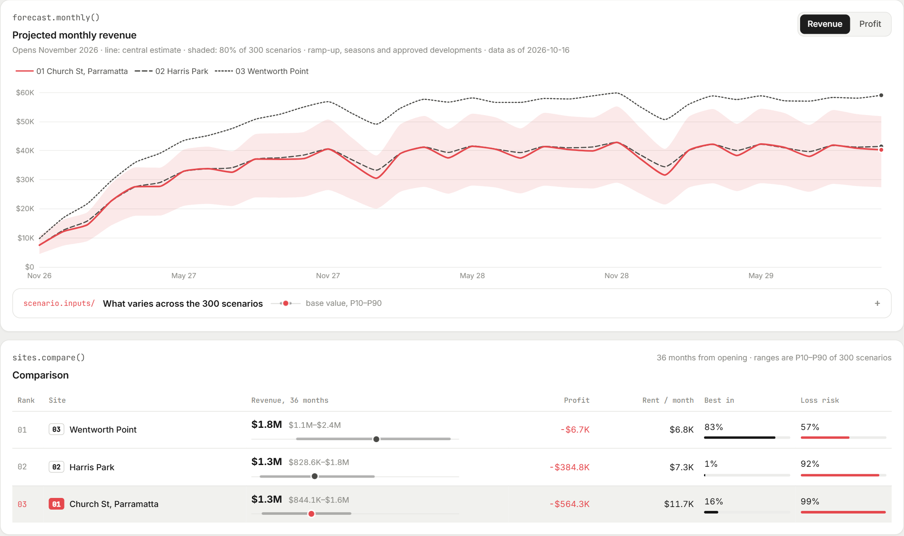
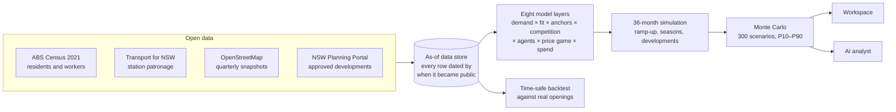
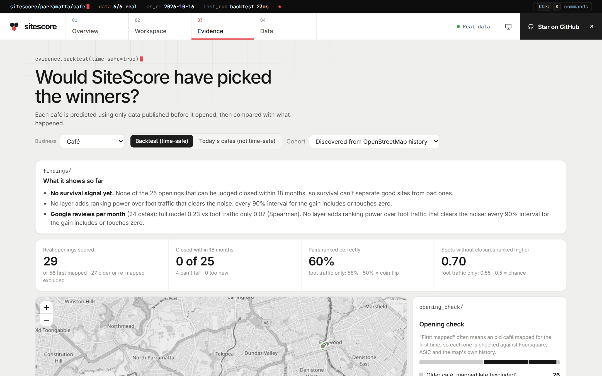
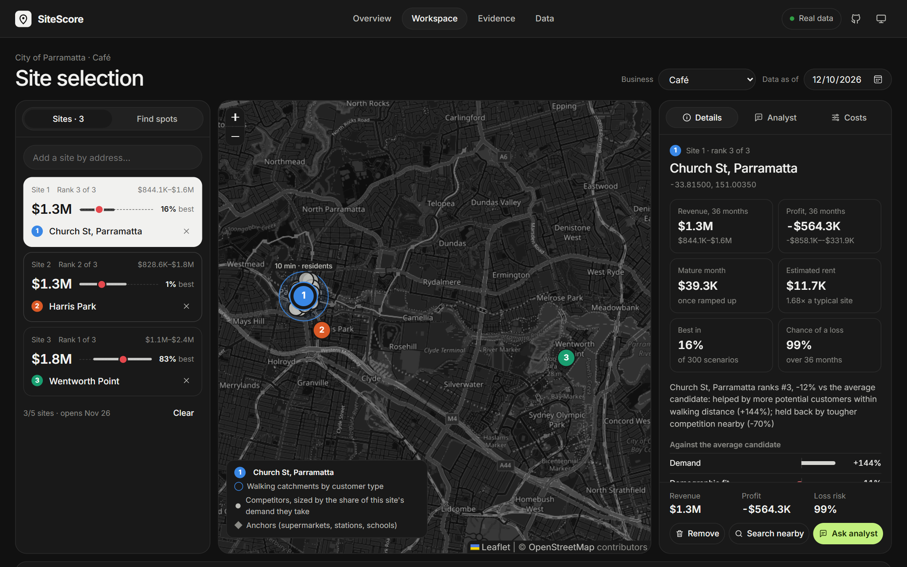
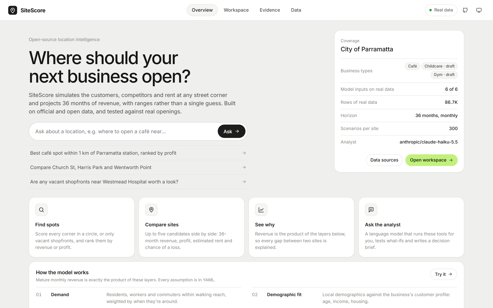
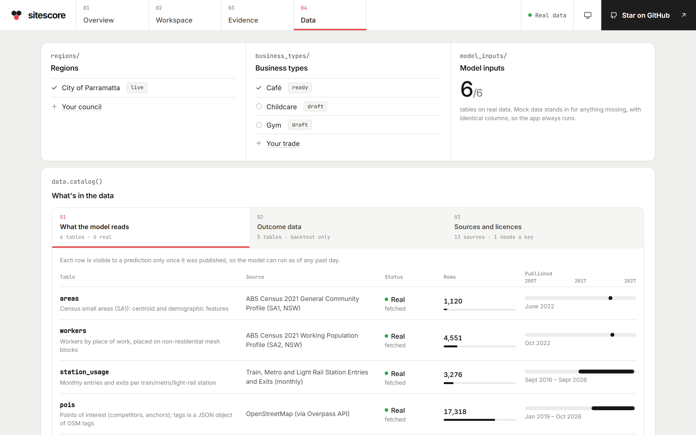

<div align="center">


# SiteScore

**Where should your next business open?**<br>
An open-source simulator that projects 36 months of revenue for any street corner, compares sites, and explains why each one wins or loses.

[](https://github.com/AR13X3/SiteScore/actions/workflows/ci.yml)
[](LICENSE)
[](pyproject.toml)
[](frontend/)
[](#help-train-sitescore)

**[Live demo](https://ar13x3.github.io/SiteScore/)** · [Quick start](#quick-start) · [Help train it](#help-train-sitescore) · [How it works](#how-it-works) · [How accurate is it?](#how-accurate-is-it) · [Docs](#documentation)

</div>



> [!IMPORTANT]
> **Help train SiteScore.** The model is built from official open data, but the parameters that turn it into dollars are still hand-set assumptions, tested against 29 real café openings in one Sydney council. Opening dates, rents, a few months of sales or a whole new region each make it more accurate, and enough of them let us **fit the model to real outcomes** instead of guesses. [See what data helps →](#help-train-sitescore) · [The data we need (#8)](https://github.com/AR13X3/SiteScore/issues/8)

## What it does

Pick a business type and a few candidate addresses, or let it search an area for you. For every site, SiteScore:

- **Simulates customers.** Residents, workers and commuters within walking reach, weighted by when they're around, from the 2021 Census and station patronage.
- **Models competition.** Every rival café on the map competes for those customers (a Huff gravity model and a few thousand simulated customers), and nearby rivals re-price when you open.
- **Projects 36 months.** Ramp-up, seasons, school holidays and approved developments landing on schedule, with **300 Monte Carlo scenarios** for P10–P90 ranges, the chance of each site being best and the chance of a loss.
- **Estimates rent and profit.** Each site's rent is scaled from foot traffic and local rents, so a busy corner with a high rent can lose to a quieter, cheaper one.
- **Explains itself.** Revenue is exactly the product of eight layers, so every gap between two sites is broken down layer by layer.
- **Maps the whole region.** Every corner of the council is scored on a 250 m hex grid, so the hotspots show at a glance; click any of them for a full run of the model.
- **Finds spots.** Draw a circle and it scores every corner (or only vacant shopfronts) and ranks the best by revenue or profit.
- **Looks back in time.** Run it "as of" any date since 2022 and it sees only the data published by then.

And it has an **AI analyst** that does the legwork: ask a question in plain English and it runs the model itself.

| Ask the analyst | Compare the results |
|---|---|
|  |  |
| It plans an investigation, calls SiteScore's own tools (spot search, 36-month simulation, catchment inspection, backtest), shows every step, and writes a downloadable decision brief. Every number it quotes comes from the model. | Revenue or profit over 36 months, with the selected site's uncertainty band, plus a side-by-side table: revenue and its range, profit, estimated rent, chance of being best and loss risk. |

## Quick start

Requires Python 3.11+ and Node.js 20+.

```bash
git clone https://github.com/AR13X3/SiteScore.git
cd SiteScore
python run.py install    # virtualenv, dependencies, frontend build (one time)
python run.py start      # http://127.0.0.1:8000
```

A fresh clone works **offline on real data**: a 3 MB demo pack (`data/demo-pack/`) loads on first start. Open the Workspace and press **Load 3 demo sites**.

To turn on the AI analyst, add an [OpenRouter key](https://openrouter.ai/keys) to `.env` and restart. Any tool-calling model works; the default is `anthropic/claude-haiku-5.5`, which costs well under a cent per question.

```bash
OPENROUTER_API_KEY=sk-or-...
OPENROUTER_MODEL=anthropic/claude-haiku-5.5
```

Everything else works without any key. `python run.py dev` runs the backend and frontend with hot reload; `python run.py test` runs the tests. See [docs/development.md](docs/development.md) for all commands.

## Help train SiteScore

SiteScore's structure is solid: every layer comes from public data, is tested, and can be switched off to measure what it adds. What it lacks is **outcome data**. The numbers that turn customers into dollars (how often people buy coffee, how far they'll walk, how rent scales with foot traffic) are educated guesses in YAML. So far the model is only checked against reality, not fitted to it.

Fitting those parameters to real results is the training step, and it needs data that no single person has:

| If you have… | It helps by… | How to share it |
|---|---|---|
| **Opening dates** of businesses you know (any Australian suburb) | More real openings to predict means a sharper test, and the evidence to fit the model | [Data contribution issue](https://github.com/AR13X3/SiteScore/issues/new?template=data-contribution.yml) or a CSV in [`backtests/cohorts/`](backtests/cohorts/) |
| **Monthly sales** or foot counts for a few businesses (anonymised) | Ground truth for fitting spend and participation: the single biggest improvement | [Data contribution issue](https://github.com/AR13X3/SiteScore/issues/new?template=data-contribution.yml): we agree a private, anonymised format first |
| **Commercial rents** or lease prices | Calibrates the rent model, which today is an index | [Data contribution issue](https://github.com/AR13X3/SiteScore/issues/new?template=data-contribution.yml) |
| Knowledge of **a council** | A new region: one YAML file and a pipeline run | [New region issue](https://github.com/AR13X3/SiteScore/issues/new?template=new-region.yml) |
| Knowledge of **a trade** (gym, bakery, pharmacy, barber…) | A new business type: one YAML profile | [Business type issue](https://github.com/AR13X3/SiteScore/issues/new?template=business-type.yml) |
| **Code** | Data adapters, walking-network distances, bus commuters | [Good first issues](https://github.com/AR13X3/SiteScore/issues?q=is%3Aopen+label%3A%22good+first+issue%22) |

**What happens to your data:** it is used to test and fit the model, and only aggregated or anonymised data is ever committed. Nothing whose licence forbids redistribution goes in the repo. Read [CONTRIBUTING.md](CONTRIBUTING.md) for the details, or start with the pinned issue, [Help train SiteScore: the data we need](https://github.com/AR13X3/SiteScore/issues/8).

## How it works



| # | Layer | What it captures |
|---|---|---|
| 1 | Demand | Residents, workers and commuters within walking reach, weighted by time of day |
| 2 | Demographic fit | Local age, income and housing against the business's customer profile |
| 3 | Anchors | Stations, supermarkets, schools and hospitals that bring people past the door |
| 4 | Competition | Huff gravity model over every rival, plus an "elsewhere" option |
| 5 | Customer agents | Thousands of simulated customers choosing by distance, price, quality and habit |
| 6 | Price response | Nearby rivals re-price in best-response rounds after you open |
| 7 | Time | Ramp-up, seasonality, school holidays, developments completing on schedule |
| 8 | Uncertainty | 300 scenarios over the key assumptions: ranges, chance of being best, chance of a loss |

**No peeking at the future.** Every stored row records when it became public. A run "as of" a date sees nothing published later, model code can only read data through that filtered view, and a test fails if anything bypasses it. Details: [docs/model.md](docs/model.md) and [docs/data.md](docs/data.md).

## How accurate is it?

Honestly: **not proven yet, and the README says so.**



The time-safe backtest predicts each café that opened in Parramatta between Nov 2022 and Dec 2024, using only data published the day before it opened, then compares the predictions with what happened.

- **29 genuine openings** survive an opening check that rejects older cafés that were simply mapped late.
- **Google reviews per month (24 cafés):** the full model ranks them with a Spearman correlation of 0.23, against 0.08 for plain foot traffic. It points the right way, but on 24 cafés the gain's 90% interval still includes zero.
- **Survival:** none of the 29 closed within 18 months, so survival can't separate good sites from bad ones yet.

More openings are the fastest way to settle it, which is why [your data](#help-train-sitescore) matters. Full results, layer-by-layer comparisons and the cross-section of today's cafés: [docs/backtest.md](docs/backtest.md).

## Data

All model inputs are official or open data: ABS Census 2021 and boundaries, Transport for NSW station patronage, OpenStreetMap (quarterly snapshots since 2019), and the NSW Planning Portal. Overture, Foursquare Open Source Places, ASIC business names and (optionally) Google Places are used **only to score the backtest**, never as model inputs. Sources, licences and caveats: [docs/data.md](docs/data.md).

<details>
<summary>Dark mode, Overview and Data screens</summary>





</details>

## Roadmap

- [ ] **Fit the model to outcomes:** learn spend, participation and walking-distance parameters from contributed data instead of hand-set YAML ([help with data](#help-train-sitescore))
- [ ] **More regions:** the rest of Greater Sydney first, then other states
- [ ] **More business types:** validate the gym and childcare drafts; add bakeries, pharmacies, barbers
- [ ] **Real rents:** NSW Valuer General land values or listing data for the rent model
- [ ] **Walking network:** real walking routes instead of straight-line distance × 1.3
- [ ] **Bus commuters:** from Transport for NSW GTFS frequencies
- [ ] **Hosted demo**

## Documentation

| Page | What's in it |
|---|---|
| [Using the app](docs/user-guide.md) | The four screens and what every control does |
| [How the model works](docs/model.md) | The layers, site-specific rent, uncertainty bands, known limitations |
| [Finding the best spots](docs/spot-finder.md) | How the spot finder searches and ranks |
| [AI analyst](docs/analyst.md) | Its tools, how it stays honest, the streaming API |
| [Data](docs/data.md) | Sources, as-of dating, mock fallback, API keys |
| [Backtest](docs/backtest.md) | Method and full results |
| [Development](docs/development.md) | Commands, configuration, repo layout |
| [Contributing](CONTRIBUTING.md) | Adding data, regions, business types and code |

**Built with** Python (FastAPI, pandas, GeoPandas, NumPy, SciPy), React and TypeScript (Vite, Leaflet, ECharts), and any OpenRouter model for the analyst.

## About

SiteScore is open source so that small businesses, which can't pay for location-intelligence consultants, can make the same kind of decision with the same kind of evidence.

If it's useful or interesting, a ⭐ helps others find it, and [one piece of data](#help-train-sitescore) helps it get better.

## Licence

Code: [MIT](LICENSE). Data in `data/demo-pack/` keeps its source licence: ABS and Transport for NSW data are CC BY 4.0, OpenStreetMap data is © OpenStreetMap contributors under the ODbL. SiteScore's projections are model estimates, not financial advice.
